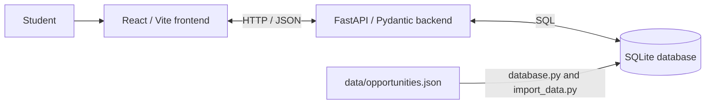

# FuturePath AU

**Explainable opportunity discovery and career-pathway planning for students and recent graduates.**

FuturePath AU is a student-focused web application prototype developed as an ATW306 industry project. It is designed to help students, including Aboriginal and Torres Strait Islander students and recent graduates, explore cybersecurity and related technology opportunities, understand published entry requirements, and plan practical next steps.

The system provides **guidance, not admissions or overall eligibility decisions**. Students should confirm current information with the relevant provider.

## Project at a glance

| | |
| --- | --- |
| **Status** | Working academic prototype (local development) |
| **Frontend** | React 18, Vite 6, JavaScript and CSS |
| **Backend** | Python, FastAPI and Pydantic |
| **Database** | SQLite |
| **Catalogue** | 30 curated opportunities and 81 eligibility conditions in total |
| **Automated testing** | 185 backend + 82 frontend = **267 passing tests** (last documented verification: 26 November 2026) |

## Key features

- **Student profiles:** Capture study background, citizenship status, academic results, skills and career preferences.
- **Opportunity discovery:** Browse and filter scholarships, internships, graduate programs and other early-career opportunities, with published sources and deadline information.
- **Explainable eligibility guidance:** Present condition-level results as `satisfied`, `unmet` or `uncertain`, with explanations and source references.
- **Prerequisite gap analysis:** Distinguish confirmed unmet requirements from conditions that need further verification, and provide optional skills to explore.
- **Personalised pathway drafts:** Generate source-grounded, structured milestones based on the selected opportunity and profile.
- **Student-controlled planning:** Edit, reorder, add, remove and explicitly approve pathway milestones in the React interface; use the browser's print function to save a copy as PDF.

### Responsible design

The prototype uses **deterministic, rule-based processing** rather than an integrated large language model. Its supported automatic eligibility comparisons currently cover **two conditions for OPP-003**: Australian citizenship and a weighted average mark of at least 50. Other conditions remain uncertain unless they can be reliably assessed; the system does not automatically assess Indigenous identity or determine overall eligibility.

The catalogue is curated rather than a live feed. Of its 30 records, 28 were marked verified in the supplied dataset, while two have unresolved verification flags. Source information and application deadlines should always be rechecked with providers.

## Architecture



The frontend manages the student experience and local pathway editing. FastAPI validates requests, retrieves opportunity records and performs eligibility, gap and pathway processing. SQLite stores the imported catalogue and eligibility requirements.

## Getting started (Windows PowerShell)

**Prerequisites:** Git, Python with `venv` and `pip`, and Node.js with npm. Use separate terminals for the backend and frontend.

### 1. Clone the repository

```powershell
git clone https://github.com/stefoaguilar/FuturePath-AU.git
cd FuturePath-AU
```

### 2. Install and initialise the backend

```powershell
cd backend
python -m venv .venv
.\.venv\Scripts\python.exe -m pip install -r requirements.txt
.\.venv\Scripts\python.exe database.py
.\.venv\Scripts\python.exe import_data.py
```

The database creation and import commands initialise a local `backend/futurepath.db` from `data/opportunities.json`. Reimporting replaces the development catalogue tables, so avoid doing it over changes you need to preserve.

Start the API:

```powershell
.\.venv\Scripts\python.exe -m uvicorn main:app --reload
```

Check **http://127.0.0.1:8000/health** or explore the interactive API documentation at **http://127.0.0.1:8000/docs**.

### 3. Install and start the frontend

Open another PowerShell terminal at the repository root:

```powershell
cd frontend
npm ci
npm run dev
```

Open **http://localhost:5173/**. Keep the backend running: the frontend calls the API at `http://127.0.0.1:8000`.

> **Other operating systems:** Use `python3 -m venv .venv` and `.venv/bin/python` in place of the Windows virtual-environment commands. The Node/npm commands are unchanged.

## Running tests

From the `backend` folder (Windows PowerShell):

```powershell
.\.venv\Scripts\python.exe -m unittest discover -s . -p "test_*.py" -q
```

From the `frontend` folder:

```powershell
npm test
npm run build
```

The documented final local checks passed **185 Python backend tests** and **82 Node.js frontend tests**, with zero failures; the Vite production build also succeeded. These results describe tested scenarios, not full production, security, accessibility or user-acceptance certification.

## Main API endpoints

| Method | Route | Purpose |
| --- | --- | --- |
| `GET` | `/api/opportunities` | Retrieve the curated catalogue |
| `POST` | `/api/eligibility/evaluate` | Return condition-level eligibility guidance |
| `POST` | `/api/gaps/analyse` | Identify confirmed unmet, uncertain and advisory development areas |
| `POST` | `/api/pathways/generate` | Generate a source-grounded, unapproved pathway draft |
| `GET` | `/api/deadlines/{opportunity_id}` | Retrieve deadline guidance for a selected opportunity |

FastAPI publishes interactive request/response schemas at `/docs` while the backend is running.

## Repository structure

```text
FuturePath-AU/
├── backend/          # FastAPI routes, SQLite access, processing modules and Python tests
├── data/             # Opportunity dataset, schema, source notes and validation scripts
├── docs/             # Student journey test documentation
├── frontend/         # React/Vite application and Node.js tests
├── tests/            # Synthetic student scenarios
└── README.md
```

For dataset-specific details, see [`data/README.md`](data/README.md) and [`data/SCHEMA.md`](data/SCHEMA.md).

## Scope and limitations

FuturePath AU is a **working prototype**, not an official application, admissions service or deployed multi-user platform.

- The application evaluates only explicitly supported eligibility rules; other requirements require student or provider review.
- A proposed LLM component was not implemented; guidance is deterministic and source-grounded.
- React-based pathway editing and approval are managed within the current browser experience. The backend also contains separate **local-development-only**, development-key-protected pathway storage endpoints; these are **not** connected to student accounts or the React approval workflow.
- Production authentication, persistent student-account workflows and comprehensive evaluation with intended users remain future development areas.
- Opportunity availability and deadlines may change after the dataset was checked.

## Project contributors

| Contributor | Primary contribution |
| --- | --- |
| **Stefano Aguilar** | FastAPI backend, SQLite integration, deterministic eligibility and pathway processing, frontend–backend integration and testing |
| **Hakm Amaireh** | React/Vite frontend, student interfaces, profile and pathway user experience, and frontend tests |
| **Samer Mohammed** | Opportunity research, dataset curation, source verification and data documentation |

Developed collaboratively for **ATW306 — Advanced Tech: Work-Integrated Learning (Industry Project)**.

---

**Disclaimer:** FuturePath AU provides educational and career-planning information only. It does not verify personal identity, guarantee eligibility, submit applications or represent an endorsement by opportunity providers or communities.
